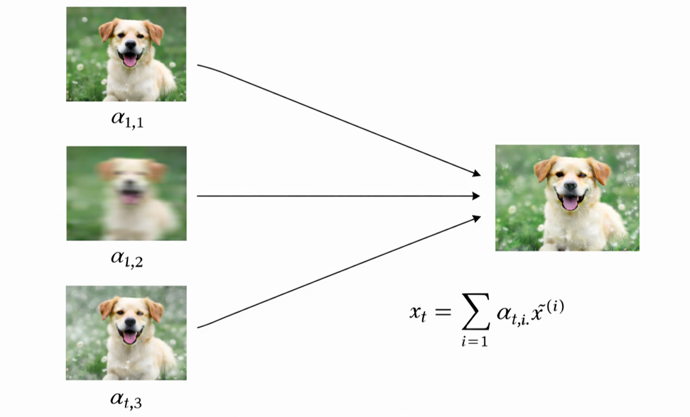

# AURA — Image Adaptation

Official implementation of **AURA (Adaptive Update through Representation Adaptation)** for image classification and test-time adaptation, accompanying the paper:

**Online Learning via Learned Latent Bayesian Tracking**  
*Advances in Neural Information Processing Systems (NeurIPS 2026)*

**[Paper (arXiv)](https://arxiv.org/abs/2609.31559)**

## Code Repositories

The implementations and experiments associated with the paper are organized into two repositories:

| Repository | Description |
|------------|-------------|
| **[AURA-Receiver](https://github.com/GersonGuy/AURA-Receiver)** | Wireless neural receiver experiments, including DeepSIC, learned latent representations, and online Bayesian tracking. |
| **[AURA-Image-Adaptation](https://github.com/GersonGuy/AURA-Image-Adaptation)** | Image classification and test-time adaptation benchmarks under distribution shifts, including comparisons with TTA baselines. |

Both repositories implement the same underlying AURA framework, adapted to their respective experimental settings.

---

## Overview

AURA (Adaptive Update through Representation Adaptation) is a gradient-free Bayesian test-time adaptation (TTA) method that performs online adaptation via extended Kalman filtering in a learned low-dimensional latent space over selected model parameters.

AURA (`methods/aura.py`) jointly adapts the FC layer and BatchNorm affine parameters grouped by network stage. AURA includes an offline meta-learning stage (`offline_train_aura.py`) that learns a low-dimensional latent representation for the adaptable model parameters from non-stationary trajectories. At test time, this learned representation is kept fixed, and online adaptation is performed by updating only the latent state using an EKF-style Bayesian update. This separation between offline representation learning and lightweight online adaptation is a central part of the method.


---

## Repository Layout

```text
methods/
  aura.py                  # AURA (FC + BN, primary contribution)
  base.py                  # TTAMethod base class
  {tent,roid,sar,cotta,santa,eata,...}.py   # standard TTA baselines
  ekf_fc.py                # parameter-space EKF baseline
  sgd_base.py              # online GD reference
  lora_base.py             # LoRA-based TTA
  {ecotta,tinytta,elatta}.py               # efficiency / gradient-free baselines
cfgs/
  {cifar10_c,cifar100_c,imagenet_c,mnist_c}/
    aura.yaml              # AURA config for that dataset
    aura_{nonlinear,vit,fc}.yaml           # variants
    offline_aura.yaml      # offline meta-training config
    {lora,ecotta,tinytta,elatta}.yaml      # new-method configs
    {tent,roid,sar,...}.yaml               # baseline configs
conf.py                    # YACS config schema
test_time.py               # main online-evaluation entry point
offline_train_aura.py      # offline meta-learning of the latent representation
offline_train_tinytta.py / offline_build_elatta_basis.py / warmup_train_ecotta.py
models/
  model.py / arch_utils.py # backbone loading (WRN/ResNet + ViT/DeiT)
scripts/
  experiments/             # main experiment runners
  ablations/               # paper ablation runners
  analysis/                # result evaluation & plotting
  measure_efficiency.py / plot_pareto.py / run_efficiency.sh
tests/
  test_{nonlinear_lifting,ecotta,tinytta,elatta,cma_es}.py
```

---

## Setup

Clone the repository:

```bash
git clone https://github.com/GersonGuy/AURA-Image-Adaptation.git
cd AURA-Image-Adaptation
```
Then create the environment using Conda or pip.
Using Conda:
```bash
conda env create -f environment.yml
conda activate tta
```

Or using pip:
```bash
pip install -r requirements.txt
```

CIFAR-10-C / CIFAR-100-C / ImageNet-C and the corresponding pre-trained backbones are fetched automatically by RobustBench on first run.

### MNIST one-time prep

MNIST is not handled by RobustBench. Two artifacts are needed:

1. **MNIST-C dataset.** Download from <https://github.com/google-research/mnist-c> and place it so that `data/mnist_c/<corruption>/{train,test}_{images,labels}.npy` exists (in particular `data/mnist_c/identity/` is used for clean training).
2. **Source ResNet-18 backbone.** Train once:
   ```bash
   python scripts/train_mnist_resnet18.py
   ```
   This writes `ckpt/resnet18_mnist.pth`, which the MNIST cfgs reference via `MODEL.CKPT_PATH`. Override with `MNIST_C_IDENTITY_DIR=/path/to/mnist_c/identity` if needed.

---

## Offline Preparation

### AURA — offline meta-training of the latent representation

The CIFAR-10 AURA configs ship with `OFFLINE_CKPT: ""` (cold-start). To reproduce the paper's offline-AURA result:

```bash
./scripts/prepare_offline.sh                    # AURA (FC + BN)
VARIANT=aura_fc ./scripts/prepare_offline.sh    # AURA-FC variant
```

Paste the printed checkpoint path into `OFFLINE_CKPT` of `cfgs/cifar10_c/aura.yaml` before running the online evaluation.

### AURA Non-linear lifting

```bash
python offline_train_aura.py --cfg cfgs/cifar10_c/offline_aura_nonlinear.yaml
```

### EcoTTA — prototype warmup

```bash
python warmup_train_ecotta.py --cfg cfgs/cifar10_c/ecotta.yaml
```

### TinyTTA — offline meta-training

```bash
python offline_train_tinytta.py --cfg cfgs/cifar10_c/tinytta.yaml
```

### ELaTTA — shift-basis construction

```bash
python offline_build_elatta_basis.py --cfg cfgs/cifar10_c/elatta.yaml
# or use the helper script:
python scripts/analysis/build_elatta_shift_basis.py
```

---

## Running Experiments

### Online evaluation

```bash
# AURA (primary)
python test_time.py --cfg cfgs/cifar10_c/aura.yaml

# AURA with non-linear lifting
python test_time.py --cfg cfgs/cifar10_c/aura_nonlinear.yaml

# AURA on ViT backbone
python test_time.py --cfg cfgs/cifar10_c/aura_vit.yaml

# LoRA TTA
python test_time.py --cfg cfgs/cifar10_c/lora.yaml

# EcoTTA
python test_time.py --cfg cfgs/cifar10_c/ecotta.yaml

# TinyTTA
python test_time.py --cfg cfgs/cifar10_c/tinytta.yaml

# ELaTTA
python test_time.py --cfg cfgs/cifar10_c/elatta.yaml

# Override any cfg key on the CLI
python test_time.py --cfg cfgs/cifar10_c/aura.yaml AURA.LATENT_DIM 128 RNG_SEED 2
```

### Data Protocol: Gradual Mixed Corruptions

The `gradual_mixed_corruption` setting defines a non-stationary test stream with a
continuously evolving data distribution. At each time step, samples are generated from
a mixture of corruption types selected from a predefined corruption set. The mixture
weights change over time according to the schedule specified in `cfg.MIXED_GRADUAL`,
so the observed domain gradually drifts throughout the evaluation rather than remaining fixed.

This protocol is controlled by the set of active corruptions, their severity, the number
of frames in the stream, and the schedule used to update the mixture weights over time.

Data generation illustration at time $t$ for a corruption set of size 2:
<p align="center">
  
</p>

Key configuration parameters in `cfg.MIXED_GRADUAL`:

| Parameter | Description |
|---|---|
| `CORRUPTION_TYPES` | Corruption types included in the mixture |
| `SEVERITY` | Corruption severity level |
| `FRAMES` | Number of time steps in the evaluation stream |
| `SCHEDULE_TYPE` | Rule used to evolve the mixture weights (`random` or `timeline`) |
| `RANDOM_MAX_STEP` | Controls the maximum per-step jump in mixture weights |
| `WAYPOINT_SPEED` | Controls the rate and smoothness of distribution drift (timeline mode) |
| `NUM_UPDATES_PER_EPISODE` | Labeled samples per adaptation step (supervised methods) |

To run the primary gradual mixed evaluation:
```bash
# AURA on the gradual mixed corruption stream
python test_time.py --cfg cfgs/cifar10_c/aura.yaml SETTING gradual_mixed_corruption
```

---

### Reproducing the paper results

The exact runners used to generate the tables and figures live under `scripts/results/` and `scripts/ablations/`:

| Script | What it produces |
|---|---|
| `scripts/results/r0_mnist.sh` | MNIST-C main-table results |
| `scripts/results/r1_datasets.sh` and `r1_trimmed.sh` | Main table across CIFAR-10-C / CIFAR-100-C / ImageNet-C |
| `scripts/results/r2_continual.sh` | Continual-shift comparison |
| `scripts/results/r3_pareto.sh` | Error vs. latency Pareto |
| `scripts/results/r4_schedules.sh` | Different non-stationary schedules |
| `scripts/results/r5_domaingen.sh` | Cross-domain generalization of the offline meta-trained representation |
| `scripts/ablations/a1_latent_dim.sh` and `a1_c100_highlatent.sh` | Latent-dimension sweep |
| `scripts/ablations/a2_stage.sh` | BN stage selection ablation |
| `scripts/ablations/a3_bn_group.sh` | BN grouping (`shared_all_bn` vs. `per_stage_bn`) |
| `scripts/ablations/a4_offline.sh` and `a4_warm_*.sh` | Offline-vs.-cold-start ablation |
| `scripts/ablations/a5_pseudolabel.sh` | Pseudo-label noise sensitivity |
| `scripts/ablations/a6_sensitivity.sh` | Hyperparameter sensitivity |
| `scripts/ablations/a7_batch.sh` | Batch-size effect |
| `scripts/ablations/a8_cache.sh` | Backbone caching speedup |
| `scripts/ablations/a_efficiency.sh` | Wall-clock efficiency comparison |
| `scripts/run_complexity.sh` and `scripts/measure_complexity.py` | Per-update complexity used in the paper's complexity analysis |

Each runner expects the working directory to be the repo root and writes logs under `logs/`
and results under `ckpt/gradual_mixed_results/<method>/<timestamp>/`.

---

### Abrupt-shift recovery experiments

```bash
# Full abrupt-shift recovery matrix (AURA vs. baselines)
bash scripts/experiments/run_abrupt_recovery_matrix.sh

# Evaluate results
python scripts/analysis/evaluate_abrupt_recovery.py
python scripts/analysis/plot_abrupt_recovery.py

# Gradual → abrupt mixed evaluation
bash scripts/experiments/a2_c10_mixed_gradual_to_abrupt.sh
```

### Efficiency benchmarking

```bash
# Run full latency / memory / FLOPs benchmark
bash scripts/run_efficiency.sh

# Or run a single method
python scripts/measure_efficiency.py --cfg cfgs/cifar10_c/aura.yaml

# Generate Pareto plot
python scripts/plot_pareto.py
```

---

## Core Hyperparameters

### AURA (`cfg.AURA`)

| Key | Default | Description |
|---|---|---|
| `LATENT_DIM` | 64 | Latent state dimension |
| `OBS_COV_SCALE` | 0.1 | Observation-noise scale (pseudo-label trust) |
| `GAMMA` | 0.999 | OU reversion strength toward source init |
| `INIT_COV_SCALE` | 0.01 | Initial diagonal covariance magnitude |
| `BN_GROUPING_MODE` | `shared_all_bn` | `shared_all_bn` or `per_stage_bn` |
| `STAGE_SELECTION` | `["stage_3"]` | Which network stages contribute BN params |
| `OFFLINE_CKPT` | `""` | Path to offline-trained latent map (`""` = cold-start) |
| `JACOBIAN_MODE` | `auto` | `auto` / `jacrev` / `jacfwd` |
| `JAC_CHUNK_SIZE` | 0 | Chunk over output dim to bound peak memory (e.g. ImageNet) |
| `USE_NONLINEAR` | `False` | Enable non-linear lifting via MLP encoder/decoder |

`cfg.AURA_FC` mirrors the first four keys plus `OFFLINE_CKPT` (no BN-specific knobs).

### LoRA (`cfg.LORA`)

| Key | Default | Description |
|---|---|---|
| `RANK` | 4 | LoRA rank |
| `ALPHA` | 16 | LoRA scaling factor |
| `LR` | 1e-3 | Learning rate |

### EcoTTA (`cfg.ECOTTA`)

| Key | Default | Description |
|---|---|---|
| `PROTO_SIZE` | 16 | Prototype memory size |
| `LR` | 1e-3 | Learning rate |

---

## Notes

- Method registration is via `@ADAPTATION_REGISTRY.register()` on the class; `cfg.MODEL.ADAPTATION` selects the method (`aura`, `tent`, `ecotta`, `tinytta`, `elatta`, `lora_base`, ...).
- Timing is measured only when `cfg.TIMING.ENABLED=True` and is written alongside accuracy results under `ckpt/gradual_mixed_results/<method>/<timestamp>/`.
- `jacrev` scales with `num_classes`; for ImageNet (1000 classes) consider `JACOBIAN_MODE: jacfwd` or set `JAC_CHUNK_SIZE > 0`.
- For ViT models, backbones are loaded via `models/arch_utils.py` using `timm`. The ViT configs in `cfgs/*/aura_vit.yaml` set `MODEL.ARCH: vit_base_patch16_224`.
- ELaTTA and TinyTTA both require an offline preparation step before online evaluation (see above).

---

## Citation and Credits
If you use this code, please cite:
```bibtex
@inproceedings{gerson2026online,
  title     = {Online Learning via Learned Latent Bayesian Tracking},
  author    = {Gerson, Guy and Raviv, Tomer and Shlezinger, Nir and Routtenberg, Tirza and Simeone, Osvaldo},
  booktitle = {Advances in Neural Information Processing Systems},
  year      = {2026},
  url       = {https://arxiv.org/abs/2609.31559}
}
```
This repository builds upon the following codebase:
<https://github.com/mariodoebler/test-time-adaptation/tree/main/classification>

If you use any of the baseline implementations included in this repository, please consider citing the corresponding original works.

The EKF-based Bayesian online update design is related to:
```bibtex
@article{jones2024bayesian,
    title={Bayesian online natural gradient ({BONG})},
    author={Jones, Matt and Chang, Peter and Murphy, Kevin},
    journal={Advances in Neural Information Processing Systems},
    volume={37},
    pages={131104--131153},
    year={2024}
}
```

